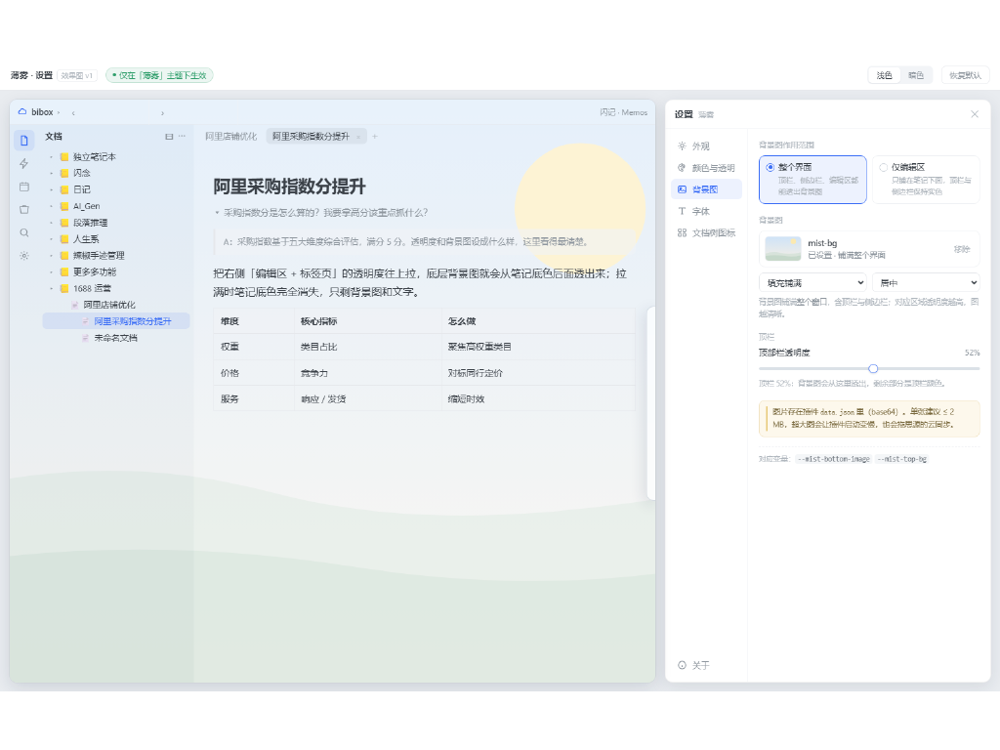

# Mist · 薄雾

A frosted, low-contrast theme for [SiYuan](https://b3log.org/siyuan).

Mist keeps the interface quiet: no hard panel frames, a translucent frosted sidebar,
soft separators, and a content area that stays readable for hours. Everything is
optional — the theme is complete on its own, and the companion plugin
[**Mist Settings**](https://github.com/dudull852/mist-enhancer) adds a control
panel for tuning it live.

## Highlights

- **No hard frames.** The top bar loses its white strip, the right dock becomes a
  hover-revealed floating strip, the status bar becomes a capsule. The document tree
  and the editor are separated by a drag bar that is invisible but still draggable.
- **Frosted glass.** Floating panels get rounded corners, blur, saturation and a soft
  shadow, on both the left document tree and the right panel.
- **Per-region opacity.** Sidebar, editor, right panel and top bar each have their own
  colour and opacity, so a background image can show through exactly as much as you want.
- **Background image.** Upload your own picture, scoped to the whole window or to the
  editor only, with fill / fit / tile placement.
- **Five one-click palettes.** Mist / Clear / Paper / wolai-like / Night Mist. A palette
  can also carry an accent colour, which is applied to SiYuan's own primary colour so
  buttons, tabs and links change together instead of ending up half-and-half.
- **Typography.** Separate fonts for body text and the document tree, independent
  document-title size.
- **Global contrast.** One slider, 0–100: lower pulls text toward the background, higher
  pushes it toward pure black or white. It only moves text, never the background.
- **Light and dark** are two separate designs, not an inverted palette.
- **Mobile** is supported.

## Install

- From the SiYuan marketplace: *Settings → Appearance → Marketplace → Themes*, search
  for `Mist`.
- Manually: unzip `package.zip` into `{workspace}/data/themes/mist/`, then restart SiYuan
  and pick *Mist* under *Settings → Appearance*.

The settings panel shown above comes from the companion plugin
[**Mist Settings**](https://github.com/dudull852/mist-enhancer). Install it from
the marketplace as well; without it the theme still renders fine with its defaults.

## Notes

- The theme is CSS only — no `theme.js`. It does not modify your data.
- Prefer the plugin for tuning. If you would rather not install a plugin, the CSS
  variables in `theme.css` are all documented at the top of the file and can be
  overridden with a code snippet.

## License

MIT
