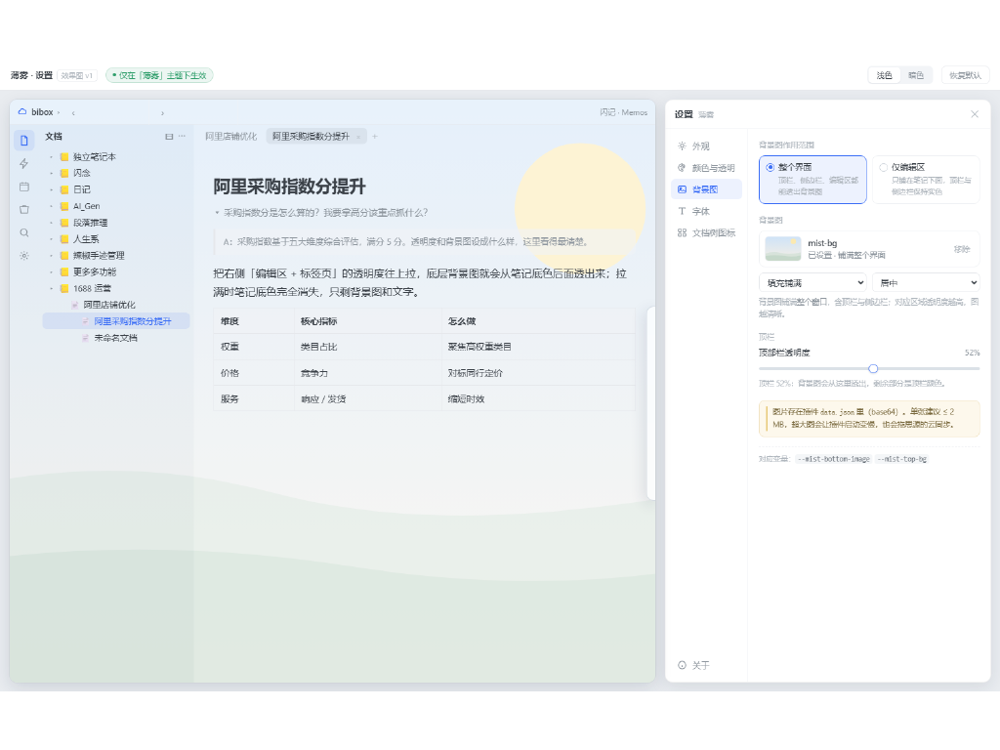
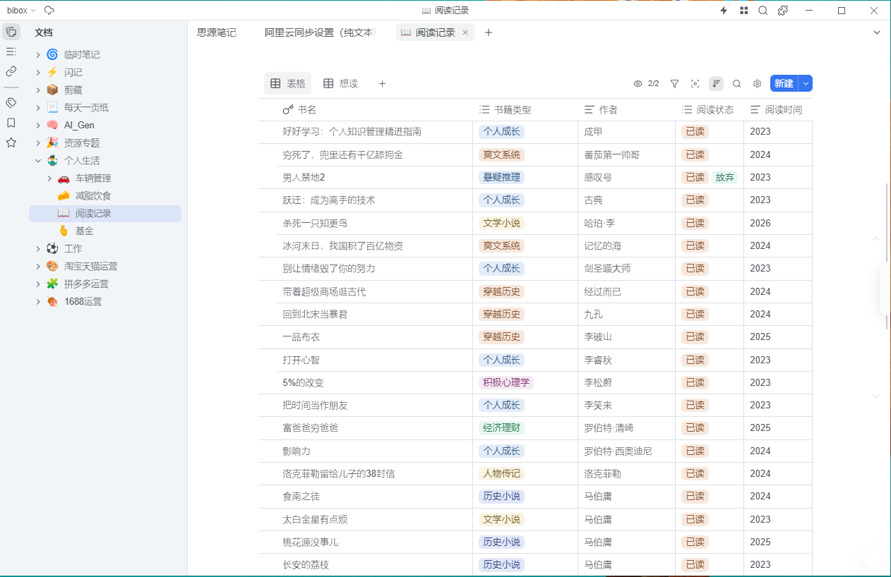
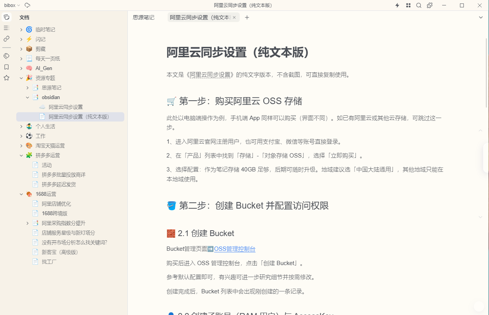
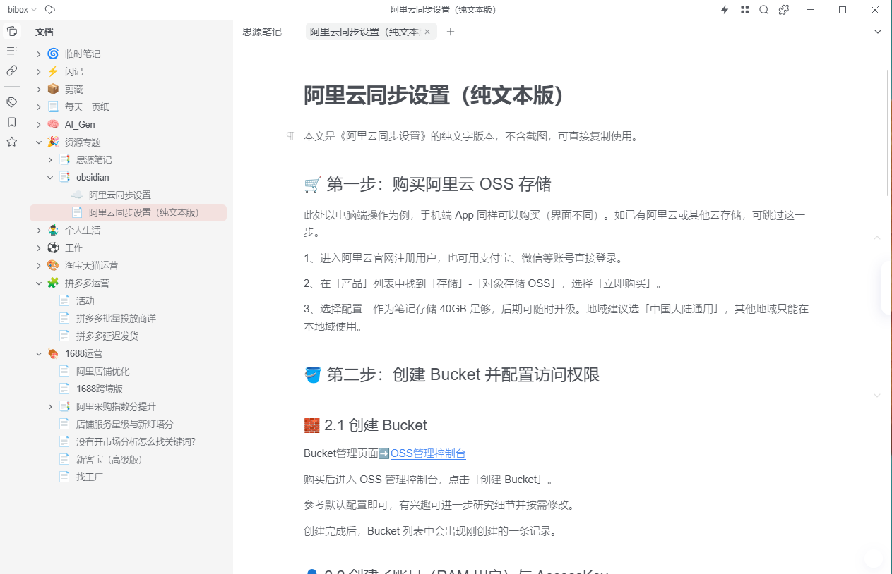
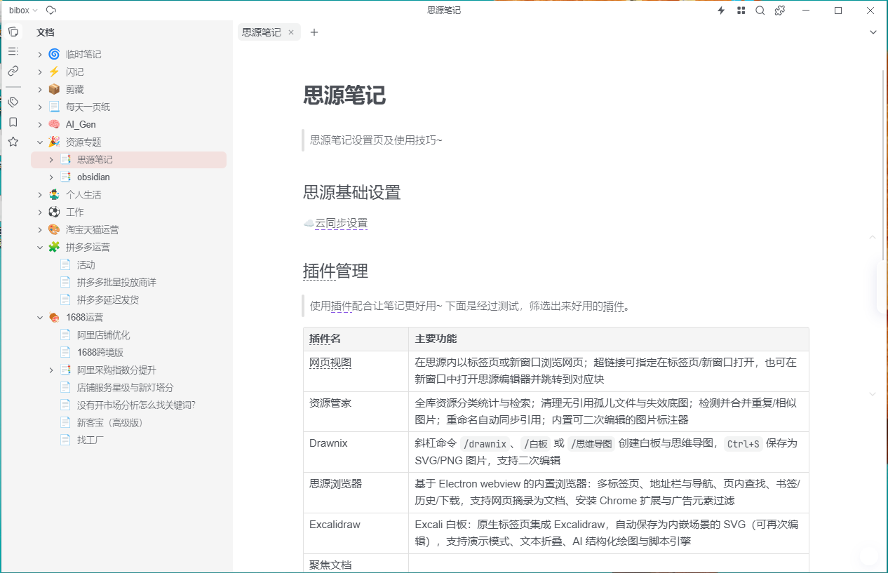
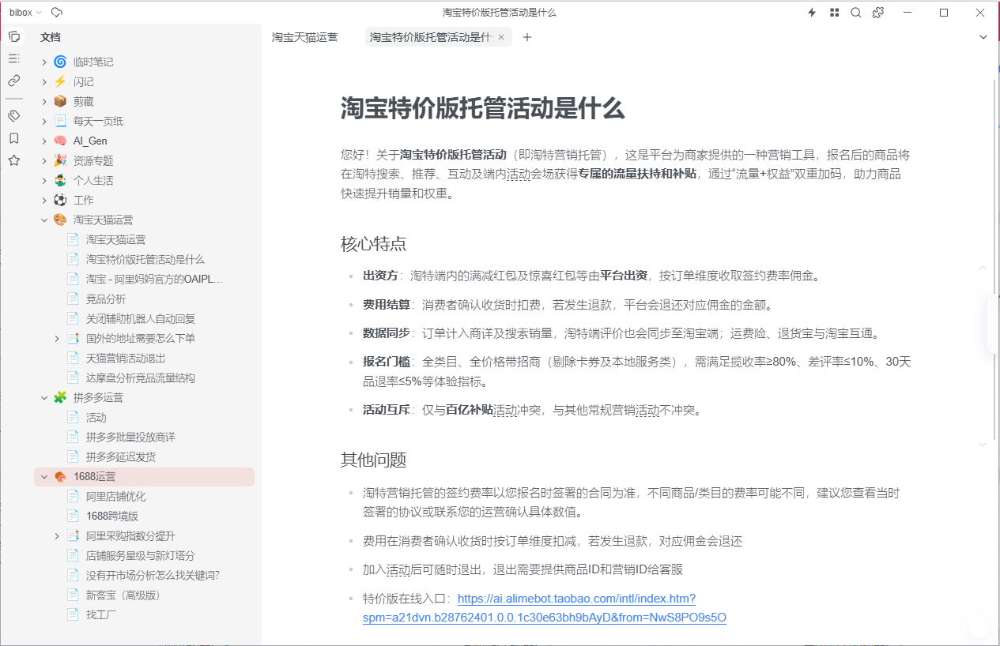

# 薄雾 · Mist

半透明磨砂、柔和低对比的 [思源笔记](https://b3log.org/siyuan) 主题。

薄雾想做的事是把界面「安静下来」：没有生硬的面板边框，侧栏是磨砂半透明的，
分割线很淡，正文区长时间看也不累。这些默认就有，**不装插件也是完整的一套皮肤**；
配套插件 [**薄雾设置**](https://github.com/dudull852/mist-enhancer) 提供可视化面板，
可以边调边看效果。

## 界面实拍

以下截图取自真实使用场景（思源 v3.8.9 + 薄雾 0.2.39），未经修饰。

**数据库表格视图** —— 表头、标签、状态列的多色标签在低对比配色下依然清晰可辨：

**长文排版** —— 标题层级、引用块、有序/无序列表、链接，行距与字重都按长时间阅读调过：

**文档树悬停态** —— 选中项是柔和浅蓝底 + 蓝字，左侧不再有硬竖线：

**标题与表格混排** —— 多级标题上留了空白，分段比默认更分明；下方表格自带细边框：

**列表与强调** —— 无序圆点缩到 0.7 倍、浓度压到 30%，不再抢正文视线：

## 特点

- **三面去框。** 顶栏去掉白条，右侧停靠栏变成悬停浮出的细条，底部状态栏收成胶囊；
  目录和正文之间的拖拽条透明但照样能拖。
- **磨砂玻璃。** 浮动面板带圆角、模糊、饱和度和柔和阴影，左侧文档树与右侧面板都适用。
- **分区透明度。** 目录+左停靠栏、编辑区+标签页、右侧面板、顶部工具栏各自独立调颜色与
  透明度 —— 想让背景图透出多少就透出多少。
- **背景图。** 可上传自己的图，作用范围可选整个界面或仅编辑区，支持铺满 / 完整显示 / 平铺。
- **5 套一键套用。** 雾 / 清透 / 纸感 / 仿 wolai / 夜雾。带强调色的预设会连思源原生主色
  一起换，按钮、标签页、链接不会出现「一半红一半蓝」。
- **字体、字号、字重都能自己填数字。** 正文、文档树、多级标题、文档标题四组独立可调，
  填完即时生效（见下方「字重调不动的坑」）。
- **表格宽度自适应。** 可选让表格宽度不超过编辑区：超出时按列比例缩窄，内容少时保持窄、
  不拉伸。
- **文档树更安静。** 每行只留一个浅浅的「＋」（新建子文档），其余操作全部隐藏，
  笔记本那一行的「⋮」也去掉了 —— 需要更多操作时用右键。
- **全局对比度。** 一个滑块 0–100，往低调文字贴近背景，往高调推向纯黑/纯白；只动文字不动背景。
- **明暗两套**是分别设计的，不是简单反色。

## 本版更新（0.2.38 → 0.2.39）

**主题**

- 文档树每行只保留浅「＋」新建子文档按钮，其余操作入口全部去掉（含笔记本行的「⋮」）。
- 文档树面板头部的 4 个功能键（聚焦 / 收起 / 更多 / 最小化）改为**鼠标移到整条头部区域
  才一起显形**，不再逐个悬停。
- 多级标题字重统一 **530**（原 600），并在标题上方补 **1.2em** 留白，段落分得更开。
- 列表符号（圆点 / 数字 / 勾选框）与文字的间距收紧：文字块左缩进 34px → 28px，
  符号不再离文字半厘米远。
- 折行的列表不再冒出孤零零的引导竖线；块标识（区块类型图标）比正文淡 75%，
  悬停时才提亮；无序列表圆点缩到 0.7 倍、浓度压到 30%。
- 表格宽度自适应编辑器宽（需在插件里打开开关）。
- 文档信息栏（图标 / 标签 / 操作按钮）**保持思源原生布局** —— 曾尝试改成横向同行排布，
  实机观感不佳，已撤回。

**配套插件（0.2.28 → 0.2.30）**

- 新增**字重可调**：正文 / 文档树 / 多级标题 / 文档标题四组，各填一个数字（100–900）
  即时生效，填完直接看效果。
- 新增**表格宽度自适应**开关：只窄不宽，超宽时按列比例缩放到编辑区宽度。
- 字体名支持从本机已装字体里挑选，也仍可手打；多个字体用英文逗号分隔。

> ⚠️ **字重调不动？** 换成**多字重字体**才行。Arial、SimHei 只有「常规 / 粗体」两档，
> 填 330、530 都会被吸附成同一个值，看起来像没反应。思源黑体（Source Han Sans SC）、
> Inter、Segoe UI、PingFang SC 都是可变字体，200/400/530/700 四档都能分辨出来。
> 中文内容推荐思源黑体。

## 安装

- 集市安装：**设置 → 外观 → 集市 → 主题**，搜索 `薄雾` 或 `Mist`。
- 手动安装：把 `package.zip` 解压到 `{工作空间}/data/themes/mist/`，重启思源后在
  **设置 → 外观** 里选 *薄雾*。

上面截图中右侧的设置面板来自配套插件
[**薄雾设置**](https://github.com/dudull852/mist-enhancer)，同样在集市里安装。
不装也能用，只是要调参数就得自己写 CSS。

## 问题反馈

遇到问题、bug 或想要建议，欢迎在**小红书**搜索账号 **`9528590876`** 反馈，
私信说明「薄雾主题 + 思源版本 + 复现步骤」即可，我会尽快处理。

也欢迎直接开 [GitHub Issue](https://github.com/dudull852/mist/issues)。

## 说明

- 纯 CSS 主题，不含 `theme.js`，不会改动你的笔记数据。
- 想调参数建议装插件。不想装插件的，`theme.css` 顶部的变量都有注释，用代码片段覆盖即可。
- 桌面端专属（`@media (hover: hover) and (pointer: fine)`），手机端保持思源原生外观。

## 许可

MIT
